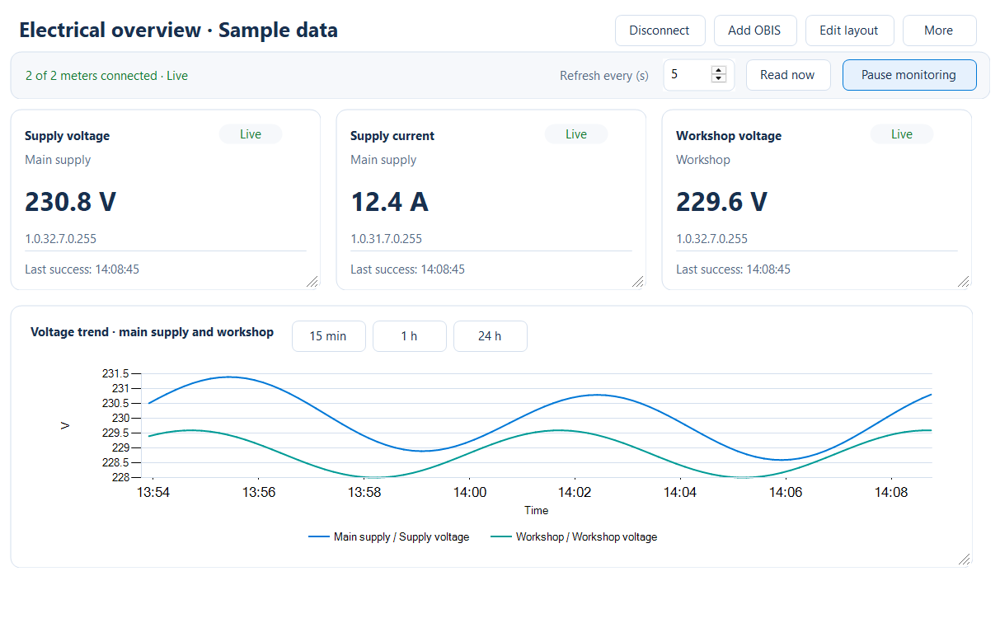

# GXDLMSDirector — Community Edition

An independent community fork of [Gurux GXDLMSDirector](https://github.com/Gurux/GXDLMSDirector), maintained by [superintelligentmeter](https://github.com/superintelligentmeter). It brings the familiar DLMS/COSEM meter tools to **.NET 10**, with refreshed Windows screens and dashboards for measurements from one or several meters.

GXDLMSDirector has been part of our team's metering work for years. We started this fork to improve that everyday experience while retaining the Gurux.DLMS protocol library at its core. Thank you to **Gurux and its contributors** for the original application and libraries this work builds on.

This is an unofficial fork, not an official Gurux release or an indication of Gurux endorsement. Original copyright, attribution and license notices remain applicable.

## Download the preview

**Current preview: 1.0.0-preview.1 · Windows x64 · GPL-2.0-only**

- **[Download the Windows installer](https://github.com/superintelligentmeter/GXDLMSDirector/releases/download/v1.0.0-preview.1/GXDLMSDirector-1.0.0-preview.1-win-x64-Setup.exe)**
- [Release notes and all downloads](https://github.com/superintelligentmeter/GXDLMSDirector/releases/tag/v1.0.0-preview.1)
- [Combined source archive](https://github.com/superintelligentmeter/GXDLMSDirector/releases/download/v1.0.0-preview.1/GXDLMSDirector-1.0.0-preview.1-source.zip) · [SHA-256 checksums](https://github.com/superintelligentmeter/GXDLMSDirector/releases/download/v1.0.0-preview.1/SHA256SUMS.txt)

The per-user installer is built in **Release** configuration and includes the .NET 10 runtime; a separate .NET installation is not required. The installer is unsigned, so Windows may display an unknown-publisher warning.

This is a preview. Automated regression checks, rendered UI checks, and an isolated install/uninstall have passed. Live meter communication was not exercised in the release validation; please evaluate it with your own meters before relying on it for operational work. See the release notes for validation details.

## Dashboard preview



*Actual application UI with generated sample readings and simulated connection states. The “Live” indicators illustrate the connected state; no physical meters were connected for this capture.*

## What this fork adds

- **.NET 10:** migrated from .NET Framework 4.8.
- **Refreshed Windows interface:** more consistent object editors, dialogs and shared controls, with improvements for different display scales.
- **Multi-meter dashboards:** value cards, numeric trend charts and tables using selected OBIS measurements from the loaded meters.
- **Customizable layouts:** drag to reorder cards and resize them from their lower-right corners.
- **Dashboards in your meter file:** layouts and measurement selections are saved inside the existing `.gxc` file.
- **Coordinated meter operations:** manual commands wait for an in-flight dashboard transaction before accessing the shared DLMS client.

The official **Gurux.DLMS 9.0.2609.2201** NuGet library remains unchanged. The application around it has changed, including the interface and coordination of meter operations.

## Start using dashboards

1. Open or configure your meters under **Devices** and load the objects you want to view.
2. If **Dashboards** is not visible, enable it under **Tools > Settings > Dashboards**, confirm with **OK**, and restart the application.
3. Right-click **Dashboards** in the navigation tree and choose **New dashboard...**. Select an existing dashboard to reopen it.
4. Choose **Add OBIS**, select a meter and its objects, then choose the attribute and display type. A dashboard can combine measurements from multiple meters.
5. Connect the meters using the dashboard's **Connect** button or the existing device commands. Monitoring starts automatically when a populated dashboard has connected meters, unless paused. Use **Read now** for a single read and the monitoring button to pause or resume polling.
6. Choose **Edit layout** to arrange the dashboard. **Done** exits editing.
7. **Save the meter file** to persist your dashboard changes in `.gxc`.

Dashboard edits are collected in the open workspace, but **Done does not save the meter file to disk**. Save the `.gxc` file before closing or switching workspaces. Live trend history is session-only and is not saved in the meter file. Disabling the dashboard feature preserves saved dashboard definitions.

## Development and feedback

This work was developed with support from **AI coding agents, including Codex and Claude**, under our team's supervision, with manual review and QA.

We are continuing to improve the user experience, strengthen reliability, and add features that support metering professionals in their everyday work. [Report a bug or suggest a feature](https://github.com/superintelligentmeter/GXDLMSDirector/issues). For bug reports, include the application version, steps to reproduce, and relevant meter or connection details; remove credentials and sensitive meter data from attachments.

## Build on Windows

Install the **.NET SDK 10.0.403** pinned in [global.json](global.json), then clone both forks into sibling directories:

```powershell
git clone https://github.com/superintelligentmeter/GXDLMSDirector.git
git clone https://github.com/superintelligentmeter/Gurux.DLMS.UI.Net.git
cd GXDLMSDirector
dotnet build Development/GXDLMSDirector46.csproj -c Release
```

Keep the directory names `GXDLMSDirector` and `Gurux.DLMS.UI.Net`; the application references the companion UI project. Despite its historical filename, `GXDLMSDirector46.csproj` now targets `net10.0-windows`.

To build the published preview from its exact inputs, use the **combined source archive** attached to the release. It includes the Director and UI source, dependency source archives, notices, and installer build instructions. GitHub's automatically generated source ZIP contains only this repository.

## Two independent versions

- **Community Edition application:** `1.0.0-preview.1`, defined in [Version.props](Version.props). This version identifies release tags and installers.
- **Gurux.DLMS library:** `9.0.2609.2201`, identifying the underlying protocol dependency.

**About** shows the application version and the actual loaded Gurux.DLMS library version separately. Updating the dependency does not automatically change the application version.

Application releases use `MAJOR.MINOR.PATCH`, optionally followed by `-preview.N`: PATCH for compatible fixes, MINOR for compatible features, and MAJOR for changes that break compatibility with supported saved files or extension interfaces. Stable releases omit the preview suffix.

## License and attribution

The application and this fork's contributions are distributed under **GPL-2.0-only**. Original Gurux and third-party notices remain applicable. See [LICENSE](LICENSE), [CREDITS](CREDITS), [MODIFICATIONS](MODIFICATIONS), and [THIRD-PARTY-NOTICES](THIRD-PARTY-NOTICES).

Release downloads include a combined source archive and dependency notices alongside the installer. When redistributing, preserve the applicable licenses, copyright and modification notices, and provide corresponding source and build/install materials for the binaries you distribute, including covered dependencies.

## Original Gurux resources and related projects

- [Companion UI fork](https://github.com/superintelligentmeter/Gurux.DLMS.UI.Net)
- [Original GXDLMSDirector](https://github.com/Gurux/GXDLMSDirector) and [original Gurux.DLMS.UI.Net](https://github.com/Gurux/Gurux.DLMS.UI.Net)
- [Gurux website](https://www.gurux.fi/) and [GXDLMSDirector overview](https://www.gurux.fi/index.php?q=GXDLMSDirector)
- [Application help](https://www.gurux.fi/index.php?q=GXDLMSDirectorHelp), [meter settings](https://www.gurux.fi/index.php?q=GXDLMSDirectorExample), and [community forum](https://www.gurux.fi/index.php?q=GXDLMSCOSEMDirectorForum)
