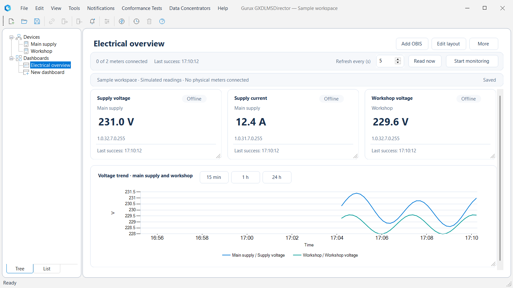

# GXDLMSDirector — superintelligentmeter fork

An unofficial community fork of [Gurux GXDLMSDirector](https://github.com/Gurux/GXDLMSDirector), maintained by [superintelligentmeter](https://github.com/superintelligentmeter). It combines the original DLMS/COSEM meter tools with an updated Windows interface and customizable multi-meter dashboards.

This is **not an official Gurux release** and does not imply Gurux endorsement. Original GXDLMSDirector and Gurux components are developed by Gurux Ltd; their copyright, attribution and license notices remain applicable.

License: **GPL-2.0-only**. The fork's contributions are distributed under the same license; original Gurux and third-party notices remain applicable. See [LICENSE](LICENSE), [MODIFICATIONS.txt](MODIFICATIONS.txt), [THIRD-PARTY-NOTICES.txt](THIRD-PARTY-NOTICES.txt), and [RELEASE-COMPLIANCE.txt](RELEASE-COMPLIANCE.txt).

## Application preview



*The application built from this fork, displaying a sample workspace with simulated readings. No physical meters are connected in this screenshot.*

## What this fork adds

- Updated Windows interface, shared control styling and DPI-aware dashboard layout.
- An embedded **Dashboards** screen alongside **Devices** in the navigation tree.
- OBIS measurement tiles, numeric trend charts and tables spanning multiple loaded meters.
- Drag-and-drop ordering, corner resizing and automatically saved dashboard layouts.
- A meter selector that uses the same loaded objects as the device tree and explains unavailable selections.
- An optional dashboard module, enabled or disabled through **Tools > Settings > Dashboards** after restarting.

The existing Gurux meter-reading and configuration tools remain part of the application. Dashboards use the existing communicator; they do not connect meters automatically. See [DASHBOARDS.txt](DASHBOARDS.txt) for behavior, limits, storage and feature switches.

## Build on Windows

Install the **.NET 10 SDK**, then clone both forks into sibling directories:

```powershell
git clone https://github.com/superintelligentmeter/GXDLMSDirector.git
git clone https://github.com/superintelligentmeter/Gurux.DLMS.UI.Net.git
dotnet build GXDLMSDirector/Development/GXDLMSDirector46.csproj -c Release -t:Rebuild
```

Keep the directory names `GXDLMSDirector` and `Gurux.DLMS.UI.Net`; the application references the companion UI project.

The protocol library remains the official Gurux.DLMS 9.0.2609.2201 NuGet package. This GPL dependency is not exempt from redistribution obligations merely because it is unmodified.

## Use dashboards

1. Load your meters under **Devices** and connect them with the existing application commands.
2. Select **Dashboards** in the navigation tree, then create or open a dashboard.
3. Choose **Add OBIS**, select a meter and its objects, then choose an attribute and display type. Measurements can come from multiple meters.
4. Use **Read now** for a single read or **Start monitoring** for repeated reads.
5. Drag cards to reorder them and use their lower-right corners to resize. **Done** exits layout editing; changes save automatically. If saving fails, **Not saved · Retry** remains visible.

Dashboard definitions are stored separately from meter files. Save the meter file after dashboard identities are first assigned so those associations survive reopening. Readings and credentials are not included in dashboard JSON.

## Related projects and original Gurux resources

- [Companion UI fork](https://github.com/superintelligentmeter/Gurux.DLMS.UI.Net)
- [Original GXDLMSDirector repository](https://github.com/Gurux/GXDLMSDirector)
- [Original Gurux.DLMS.UI.Net repository](https://github.com/Gurux/Gurux.DLMS.UI.Net)
- [Gurux website](https://www.gurux.fi/) and [GXDLMSDirector overview](https://www.gurux.fi/index.php?q=GXDLMSDirector)
- [Gurux application help](https://www.gurux.fi/index.php?q=GXDLMSDirectorHelp), [meter settings](https://www.gurux.fi/index.php?q=GXDLMSDirectorExample), and [community forum](https://www.gurux.fi/index.php?q=GXDLMSCOSEMDirectorForum)
- [Gurux community updates](https://twitter.com/guruxorg)

## Distribution and attribution

Keep the original Gurux copyright, GPL and third-party notices intact. Fork modifications and their notices are recorded in [MODIFICATIONS.txt](MODIFICATIONS.txt); dependency notices are in [THIRD-PARTY-NOTICES.txt](THIRD-PARTY-NOTICES.txt).

Before distributing executables, installers or dependency DLLs, follow [RELEASE-COMPLIANCE.txt](RELEASE-COMPLIANCE.txt), including the complete corresponding-source requirements. A source repository or screenshot does not by itself satisfy every binary-release obligation.
